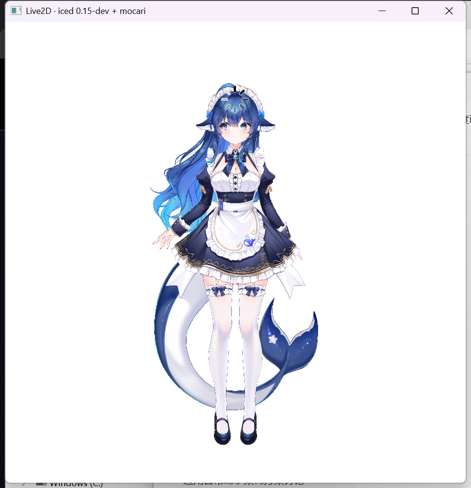

# Live2D on iced — working spike

A minimal, **running** proof that a Live2D Cubism model can be rendered inside an
[iced](https://github.com/iced-rs/iced) desktop application with pure Rust — no
Cubism Core binary, no C++ toolchain, no engine.

- `iced` master `e5c350f` (`0.15.0-dev`) + default `wgpu` renderer
- `mocari` `0.4.1` (MIT) for `.moc3` parsing, motion/expression/physics, and the
  wgpu renderer
- `wgpu` `30.0.2`



## What is verified

| Capability | Status |
|---|---|
| Model + textures load, correct colours | ✅ |
| Clipping masks (eyes, mouth, hair, body behind tail) | ✅ |
| Motion playback, looping, switching | ✅ `R` |
| Expressions (23 scanned from disk) | ✅ `E` |
| Physics (hair/tail follow) | ✅ |
| Gaze follows the cursor (head + eyes + torso) | ✅ |
| Window resize keeps framing | ✅ |
| Headless offscreen render to PNG | ✅ `examples/offscreen.rs` |
| Frame rate (release, 715 drawables) | ✅ ~50 fps, CPU-bound |
| Desktop-pet shell (transparent / on-top / click-through / tray) | ❌ not started |
| Breathing / eye blink ( /  equivalents) | ❌ not started |
| Blink / breath / lip-sync | ❌ not started |

| iced window | offscreen render |
|---|---|
|  |  |

Gaze tracking, cursor left vs right — head, eyes, shoulders and hair all move because the
driver writes the rig's *tracking inputs* (`AngleX/Y/Z`, `Position*`, `LeanInput`) and lets physics
derive `ParamAngle*`:


## Requirements

- Rust **1.93+** (iced master's MSRV; edition 2024)
- A GPU with Vulkan/DX12/Metal for `wgpu`
- A Live2D model directory (`*.model3.json` + `*.moc3` + textures). **None is
  committed** — model assets are copyrighted.

## Quick start

```bash
# one-time: vendor the patched mocari (see "The one patch" below)
powershell -NoProfile -ExecutionPolicy Bypass -File scripts/vendor-mocari.ps1

# run with any model
cargo run --release -p app -- "path/to/model/xxx.model3.json"
```

Use `--release`. A debug build runs at ~5 fps because the per-frame CPU mesh work
for hundreds of drawables is unoptimised, which also makes animation look like
slow motion (each frame's delta is clamped to 0.1 s).

**Controls:** `R` next motion clip · `E` next expression · move the mouse over
the window to make the model follow it.

## Memory

The rig's five atlases are 4096x8192, 4096x8192, 2048x2048, **8192x8192** and
4096x4096 — 592 MB uncompressed. `load_model_runtime` keeps the decoded RGBA
alive inside `RuntimeModel`, so holding onto it costs CPU *and* GPU copies
(measured 1 565 MB). The scene clones the runtime, drops the assets, and uploads
at half resolution by default:

| | working set |
|---|---|
| naive (keeps decoded textures, full res) | 1 565 MB |
| assets dropped, full res | ~900 MB |
| assets dropped, `texture_scale = 0.5` (default) | **462 MB** |

Pass `SceneOptions { texture_scale: 1.0, ..Default::default() }` for full quality.

## Layout

```
crates/live2d-render/          engine-agnostic: depends on wgpu + mocari only
  src/bounds.rs                canvas info -> view-fit matrix
  src/scene.rs                 Live2dScene: load, advance, encode mask+model passes
  src/error.rs                 error taxonomy
  examples/dump.rs             model anatomy dump (drawables, masks, canvas, motions)
  examples/offscreen.rs        render one frame without a window -> PNG

app/                           the iced shell
  src/main.rs                  application, subscription, keyboard
  src/live2d.rs                Program + Primitive + Pipeline (~200 lines)

patches/                       the mocari fix, as a patch file
scripts/vendor-mocari.ps1      rebuilds .refs/mocari from the registry + patch
scripts/shot.ps1               DPI-aware window screenshot (dev tool)
docs/                          the feasibility write-up and the plan
```

The split matters: keeping `live2d-render` free of iced means a `wgpu`/`iced`
upgrade touches one layer, and the renderer stays testable headlessly.

## The one patch

`mocari 0.4.1` cannot open this model: one of its 715 drawables carries
`masks == [-1]`, a sentinel some exporters write for "not masked", and mocari
feeds it straight into a `usize` conversion:

```
failed to create a clipping layout: invalid mask drawable index -1
```

Filtering negative mask entries treats that drawable as unmasked, which is the
only sensible reading. The fix lives in
[`patches/mocari-0.4.1-negative-masks.patch`](patches/mocari-0.4.1-negative-masks.patch)
and is applied to a vendored copy at `.refs/mocari` (wired up through
`[patch.crates-io]` in `Cargo.toml`). This belongs upstream — it should not be
every consumer's problem.

## Why the git dependency on iced

`mocari`'s wgpu backend needs `wgpu 30`, which is what iced **master** uses
(`0.14.0` is still on `wgpu 27`). Pinning master also pins the whole `wgpu`
major, so `WgpuLive2dRenderer` links straight into `Pipeline`. It is pinned by
`rev`, and iced pins its own git dependencies by `rev` too, so builds are
reproducible. When 0.15 ships, switch to the crates.io version — the ~200 lines
of glue should not need changes.

## Things worth knowing before extending this

- **Framing must come from the `.moc3` canvas**, not from a bounding box of all
  drawables. This model has 715 drawables including hidden spares (props, spare
  hands, alternate body types); bounding-box centring visibly offsets the
  character. See `ModelBounds::from_canvas`.
- **`model3.json` is not always complete.** Here it declares zero motions and
  zero expressions while the files sit in `Animation/` and `Exp3/`. `Live2dScene`
  scans the model directory as a fallback and plays `IDLE*` first.
- **Colour space:** the `format` handed to `Pipeline::new` was `Bgra8Unorm`
  (non-sRGB), which matches mocari's gamma-space blending. If a platform gives
  you `*UnormSrgb`, you must render into your own `Rgba8Unorm` target and do
  gamma→linear when compositing, or the model washes out.
- **`Primitive::draw` must return `false`** and the work must happen in
  `Primitive::render`, because the mask pass has to be inserted between the
  passes iced controls.

## Troubleshooting (this machine only)

If `cargo build` fails with `schannel: AcquireCredentialsHandle failed`
(`SEC_E_NO_CREDENTIALS`), the process is sandboxed: Windows TLS refuses to hand
out credentials to restricted processes, so **every** HTTPS client (curl, git,
cargo) fails while plain TCP still connects. Run the build outside the sandbox —
this is not a project problem.

## Docs

- [`docs/rust-iced-live2d-plan.md`](docs/rust-iced-live2d-plan.md) — verified
  architecture, iced 0.15-dev API notes, pitfalls, calibrated effort estimate
- [`docs/live2d-native-feasibility.md`](docs/live2d-native-feasibility.md) —
  broader survey of Live2D on native platforms (platform matrix, licensing,
  difficulty ladder)
