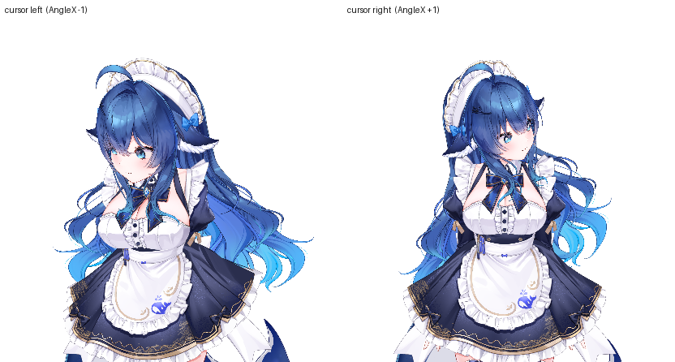

# Live2D on iced — working spike

A minimal, **running** proof that a Live2D Cubism model can be rendered inside an
[iced](https://github.com/iced-rs/iced) desktop application with pure Rust — no
Cubism Core binary, no C++ toolchain, no engine.

- `iced` master `e5c350f` (`0.15.0-dev`) + default `wgpu` renderer
- `mocari` `0.4.1` (MIT) for `.moc3` parsing, motion/expression/physics, and the
  wgpu renderer
- `wgpu` `30.0.2`


## What is verified

| Capability | Status |
|---|---|
| Model + textures load, correct colours | ✅ |
| Clipping masks (eyes, mouth, hair, body behind tail) | ✅ |
| Mipmapped textures — thin line art survives minification | ✅ (local patch) |
| Motion playback, looping, switching by `(group, clip)` | ✅ `R` |
| Expressions (23 scanned from disk, host opts in) | ✅ `E` |
| Physics (hair/tail follow) | ✅ |
| LookAt follows the cursor (head + eyes + torso) | ✅ |
| Window resize keeps framing | ✅ |
| Typed interface, validated at load | ✅ `examples/typed.rs` |
| Parameter / part overrides, replayed every step | ✅ `M` / `C` / `H` |
| Hit areas, hover/press/drag/wheel events | ✅ |
| Headless offscreen render to PNG | ✅ `examples/offscreen.rs` |
| Frame rate (release, 715 drawables) | ✅ 60 fps pinned: deform 2.5 ms + upload 0.9 ms per frame |
| Desktop-pet shell (transparent / on-top / click-through / tray) | ❌ not started |
| Breathing / eye blink / lip-sync | ❌ not started |

| iced window | offscreen render |
|---|---|
|  |  |

## Fidelity against the official viewer

Same model, both in a neutral pose: the official Cubism Viewer 5.3 on the left,
this renderer at `texture_scale = 1.0` on the right. Colours, mask edges, blend
modes and draw order match. The two captures are not frame-synchronised, so the
physics phase differs (mouth and hair sit a little differently).


LookAt, cursor left vs right — head, eyes, shoulders and hair all move because the
driver writes the rig's *look-at inputs* and lets physics derive `ParamAngle*`.
Which inputs those are is resolved per rig, so the rig in this repo takes
`AngleX`/`AngleY`/`PositionX`/`PositionY` while a classic rig takes the
`ParamAngle*` names; `LIVE2D_TRACK` and `examples/rig` show both tables. See
`Model::set_look_at` and `Model::set_look_at_mode`.



## Requirements

- Rust **1.93+** (iced master's MSRV; edition 2024)
- A GPU with Vulkan/DX12/Metal for `wgpu`
- A Live2D model directory (`*.model3.json` + `*.moc3` + textures). **None is
  committed** — model assets are copyrighted.

## Quick start

```bash
# one-time: vendor the patched mocari (see "The two patches" below)
powershell -NoProfile -ExecutionPolicy Bypass -File scripts/vendor-mocari.ps1

# open the default rig
cargo run --release -p app

# open any model by name, or by path
cargo run --release -p app -- --model Hiyori
cargo run --release -p app -- "path/to/model/xxx.model3.json"

# what can be named
cargo run --release -p app -- --list
```

`--model <name>` matches a model directory or file stem, case-insensitively,
inside `models/`, `.refs/models/`,
`.refs/cubism-web-samples/Samples/Resources/` and the rig under development.
`--track viewer` switches to the Cubism Viewer's own bindings (see
[the tracking section](#capturing-a-frame-without-a-window)). `--help` lists
everything.

Use `--release`. A debug build runs at ~5 fps because the per-frame CPU mesh work
for hundreds of drawables is unoptimised, which also makes animation look like
slow motion (the scene drops time it cannot catch up on).

**Controls:** `R` random clip of the next motion group · `E` next expression ·
`C` clear expressions · `S` stop the motion · `P` pause · move the mouse over the
window to make the model follow it, and click it to see which hit area it reports.

## Frame pacing

`Model::advance` takes whatever interval the host measured and spends it in
fixed 1/60 s steps, keeping the rest for the next call. The pose is therefore a
function of elapsed time alone, not of how the host sliced it.

A host can hand the scene a **zero-length** interval, and desktop windows do: an
iced window delivers roughly 2–10% of its frames with an instant that equals the
previous one, so `advance` gets `delta == 0` several times per second. Treating
such a frame as a real one is what used to make parts flicker — `advance` reset
every parameter to its default and then `apply_physics(0.0)` returned before
writing the physics outputs, so for one frame the hair, skirt and accessories
snapped to their rest pose and back. Only the parts the cursor does not drive and
physics does are affected, which is why it looked like isolated components
blinking. Under `--model 大肥鱼` the same bug is invisible in practice: that rig
took ~28 ms per frame, so the duplicate instant almost never happened for it.

The component that ships here drives its own frames and runs at a steady 16.7 ms
even on the models where the old subscription-based loop averaged 23 ms with a
quarter of its frames zero-length.

`LIVE2D_PROFILE=1` makes the app ask the widget for its diagnosis, printed once
per 60 frames. The component never prints on its own; `.profile(true)` is what
turns it on:

```
live2d profile: 60 frames 1.00 steps, step 0.08 ms, deform 3.40 ms, upload 1.42 ms, delta 15.2..18.4 ms (mean 16.67)
```

`steps` above 1 means the host presents slower than 60 Hz and the model is catching
up; `step` is the motion/expression/physics update for those steps, `deform` the
CPU mesh rebuild and `upload` the GPU write. They are reported apart on purpose: on
a 715-drawable rig the split says whether the cost is the simulation or the
buffers.

## Framing

The model is framed by the **canvas** rectangle in the `.moc3` header, the same
box Cubism Editor and the Viewer use, not by the bounding box of the artwork. A
model whose art leaves spare room in its canvas therefore looks smaller and
off-centre in every host, ours included — `Rice` has a 1.5:1 landscape canvas
with the art filling 66% x 85% of it and sitting 6% right and 6% below the canvas
centre, so in a square window it occupies 61% x 53% of the width and height
where `Haru` occupies 40% x 83%. `cargo run --release -p live2d-render --example
inspect -- <model>` prints those numbers under `== framing ==`, so a framing
complaint can be answered with data instead of a guess.

## Capturing a frame without a window

`examples/offscreen.rs` renders into a texture and writes a PNG. Every piece of
state is an environment variable, so a capture is reproducible from the command
line alone:

```bash
cargo run --release -p live2d-render --example offscreen -- \
  "path/to/model/xxx.model3.json" frame.png 900 30
```

| Variable | Meaning |
|---|---|
| `LIVE2D_TEXTURE_SCALE` | upload resolution multiplier, default `1.0` |
| `LIVE2D_MASK` | mask render-target edge in pixels, default `1024` |
| `LIVE2D_MOTION` | `group,clip` to play before the capture |
| `LIVE2D_EXPR` | expression index to apply before the capture |
| `LIVE2D_LOOK_AT` | `x,y` in `-1.0..=1.0`, applied as the cursor position |
| `LIVE2D_HIT` | `x,y` in `-1.0..=1.0`: print which hit area a click there would land in |
| `LIVE2D_FILL` | how much of the widget the model's bounds span (`1.0` touches the edges, default `0.925`) |
| `LIVE2D_CLEAR_EXPR`, `LIVE2D_NO_MOTION`, `LIVE2D_NO_PHYSICS`, `LIVE2D_RECLIP` | flags — active when the variable is present, whatever its value |
| `LIVE2D_PROFILE` | flag, read by the app — asks the widget for the per-frame step count, step/deform/upload cost and frame-interval statistics |

`sweep` and `jolt` take their own knobs:

| Variable | Used by | Meaning |
|---|---|---|
| `SWEEP_DIRECT`, `SWEEP_RANGE`, `SWEEP_ALL`, `SWEEP_JUMP`, `SWEEP_SETTLE`, `SWEEP_MOTION` | `sweep` | drive one parameter instead of the look-at target, input range, watch every parameter, jump threshold, settle frames, keep the motion playing |
| `JOLT_RANGE`, `JOLT_SIZE`, `JOLT_SETTLE`, `JOLT_MOTION`, `LIVE2D_NO_PHYSICS` | `jolt` | input range, capture size, settle frames, keep the motion playing, disable physics |

`LIVE2D_TRACK` picks how the cursor reaches the model, for the app and every
example:

- `adapted` (default) — resolve what the rig was authored for. A rig built for
  VTube Studio takes head rotation on `AngleX`/`AngleY` and body motion on
  `PositionX`/`PositionY`; physics then derives `ParamAngle*` and
  `ParamBodyAngle*`. Measured on the rig in this repo: 11 593 changed pixels per
  frame across a full sweep (head, torso, hair, tail).
- `viewer` — reproduce the Cubism Viewer's own mouse bindings
  (`ParamAngleX`/`ParamAngleY`/`ParamBodyAngleX` + the eyes). Those are *physics
  outputs*, so physics overwrites them and only the eyes respond: 20 changed
  pixels per frame. Use this when comparing frames against the Viewer.

`examples/rig` prints both tables for a model in a second, without a GPU:

```
$ cargo run -p live2d-render --example rig -- "…/大肥鱼.model3.json"
== adapted ==
  head-yaw    -> AngleX             through-physics  (physics-input)
  body-yaw    -> PositionX          through-physics  (physics-input)
  eye-x       -> ParamEyeBallX      direct           (convention)
== viewer ==
  head-yaw    -> ParamAngleX        direct           (viewer-default)
```

## Other examples

| Example | Answers |
|---|---|
| `dump` | what is in the `.moc3`: drawables, mask sets, canvas, motion groups |
| `inspect` | what is in the *files*: physics settings, motion curves, expression targets, and how the art sits inside the canvas |
| `probe <model> <x> <y>` | which drawables cover a model-space point, in paint order |
| `switch <model> <Param> <v0> <v1>` | which drawables a parameter flips, and their metadata |
| `sweep` | what physics does along a horizontal sweep of the look-at target |
| `jolt` | how many pixels change per frame during a slow sweep, and where |
| `rig` | how cursor tracking is routed for a model, in both modes — no GPU needed |
| `offscreen` | one frame to a PNG, no window |

The component has its own examples, which need a window:

| Example | Answers |
|---|---|
| `minimal` | two models in one window through the `Raw` interface, keyed by their `Live2dId`; keys `R`/`E`/`P`/`1`/`2`, every component event printed |
| `typed` | a host-declared interface: typed keys for parameters, parts, motions and hit areas, and the load failure a model that lacks them produces |
| `interact` | every input mapped to a message: click, double click, long press, drag, drag end, scroll (zooms the pane), hover, and gaze driven by the pointer |

`cargo run -p iced-live2d --example minimal -- <model.model3.json> [<second>]`
`cargo run -p iced-live2d --features macros --example typed -- <model.model3.json>`
`cargo run -p iced-live2d --example interact -- <model.model3.json> [<second>]`

`sweep` is the fastest way to check a tracking bug: it prints the input parameter
and the physics outputs per frame, and flags any frame-to-frame jump. Prefix it
with `SWEEP_DIRECT=<ParamId>` to write that parameter directly instead of driving
the look-at target.

`inspect` takes `LIVE2D_PARAMS=<substring>[,<substring>...]` to dump the matching
parameters with their ranges and current values, which is how you confirm a
parameter exists at all before blaming the renderer.

## Memory

The rig's five atlases are 4096x8192, 4096x8192, 2048x2048, **8192x8192** and
4096x4096 — 592 MB uncompressed. `load_model_runtime` keeps the decoded RGBA
alive inside `RuntimeModel`, so holding onto it costs CPU *and* GPU copies
(measured 1 565 MB). The scene clones the runtime, drops the assets, and uploads
at half resolution by default:

| | working set |
|---|---|
| naive (keeps decoded textures, full res) | 1 565 MB |
| assets dropped, full res | ~900 MB |
| assets dropped, `texture_scale = 0.5` (default) | **462 MB** |
| the above + mip chain (textures x 4/3) | ~511 MB |

Pass `SceneOptions { texture_scale: 1.0, ..Default::default() }` for full quality.

Hosting the same model in a Chromium webview running the official Cubism Web SDK
costs **3.2× the memory of this app**: 1 252 MB private working set against
388 MB for the rig, 309 MB against 118 MB for the small sample model, with a
blank webview already sitting at 193 MB. Method, the full table, and the two SDK
traps found on the way: [`docs/web-sdk-benchmark.md`](docs/web-sdk-benchmark.md).

## Layout

```
crates/live2d-render/          engine-agnostic: depends on wgpu + mocari only
  src/info.rs                  AssetId, ModelInfo: what a model declares
  src/asset.rs                 Asset/Prepared: parse, upload, scan when asked
  src/model.rs                 Model: parameters, player, expressions, physics
  src/gpu.rs                   ModelGpu: mesh buffers, clipping, mask target
  src/view.rs                  View: framing + the inverse a hit test needs
  src/bounds.rs                canvas info -> view-fit matrix
  src/rig.rs                   per-model look-at routing (which params a target writes)
  src/error.rs                 error taxonomy
  examples/*.rs                the diagnostics listed above
  examples/shared/session.rs   the smallest correct driver, shared by those examples
  examples/shared/gpu.rs       headless GPU bootstrap
crates/iced-live2d/            the reusable component: iced + live2d-render
  src/interface.rs             Interface, Vocabulary, VocabularySpec, KeyId, Mapping
  src/raw.rs                   Raw: the model's own entries as an interface
  src/model.rs                 Live2dAsset + Live2dModel<I>: budgets, keys, commands
  src/widget.rs                Live2d widget + Live2dState (channel, pacing, hooks)
  src/pipeline.rs              the three tables (asset/model/view) + the primitive
  src/interaction.rs           PointerEvent, Pointing/Tap/Drag/Hovering, Sample, Gesture
  src/gesture.rs               the classifier: clicks, holds, drags, double clicks
  src/event.rs                 Live2dEvent<I>, Problem, LoadFailure
  src/look_at.rs               LookAtSource + look_at::cursor
  examples/minimal.rs          two models through Raw, keyed by Live2dId
  examples/typed.rs            a host-declared interface (needs `macros`)
  examples/interact.rs         every input mapped to a message
crates/iced-live2d-macros/     the optional `Vocabulary` derive
app/                           the demo app, now a thin host of the component
  src/main.rs                  CLI dispatch, key bindings, event printing
  src/cli.rs                   --model / --track / --list
patches/                       the four mocari fixes, as patch files
scripts/vendor-mocari.ps1      rebuilds .refs/mocari from the registry + patches
scripts/shot.ps1               DPI-aware window screenshot (dev tool)
scripts/shot-window.ps1        screenshot any window by title prefix (dev tool)
docs/                          feasibility write-up, plan, audit, design, defect records
```

The split matters: keeping `live2d-render` free of iced means a `wgpu`/`iced`
upgrade touches one layer, and the renderer stays testable headlessly. Above it,
`iced-live2d` is the only crate that knows about iced, and `app` is the only place
with policy.

## Using the component

`iced-live2d` draws a model as an ordinary iced widget. The host owns an **asset**
and one or more **models** built from it; the widget borrows a model, and
everything else — textures, GPU state, frame pacing, look-at routing, hit testing —
is behind the component. There is no frame subscription to write and no iced
plumbing to copy:

```rust
use iced_live2d::{
    AssetOptions, Live2dAsset, Live2dModel, ModelOptions, Raw, live2d, look_at,
};

struct App {
    hiyori: Live2dModel<Raw>,
}

fn new() -> App {
    let asset = Live2dAsset::new(
        "Hiyori.model3.json",
        AssetOptions { texture_scale: 0.5, scan_sidecars: true },
    );
    let hiyori = Live2dModel::<Raw>::new(&asset, ModelOptions::default());
    App { hiyori }
}

fn view(app: &App) -> impl iced::Widget<Message> {
    live2d(&app.hiyori)
        .on_event(Message::Live2d)
        .look_at(look_at::cursor)
}
```

The asset/model split is what makes several instances cheap: they share the
textures and the parsed model, and each keeps its own parameter values, playback
position and physics state.

Both constructors take their budget explicitly, and there is no variant that
invents one: whether to spend 592 MB of VRAM on 4096px textures or 37 on
half-size, and whether a folder of animation files is a loop set, are not things a
component can guess. `AssetOptions::default()` and `ModelOptions::default()` are a
starting point to override, not a hidden decision.

### The modelling: assets, models, views

| Type | Owns | Lifetime |
|---|---|---|
| `Live2dAsset` | file path, texture budget (`AssetOptions`) | as long as any model of it, plus itself |
| `Live2dModel<I>` | parameters, parts, playback, physics, budgets (`ModelOptions`) | the host's |
| `Live2d<'_, Message, I>` | framing, pointer, event channel | while it is in the UI tree |

Above the component the same split appears as `live2d_render::{Asset, Model,
ModelGpu, View}`, and `Model` there is pure CPU: it can be stepped, hit-tested and
read back without a device.

### Declaring what the model must offer

A model is driven through a **vocabulary**: five lists of names the host declares
in enums and promises the model has. Declaring one is `impl Interface` plus the
enums; the derive (`--features macros`) writes the four vocabulary items:

```rust
#[derive(Clone, Copy, PartialEq, Eq, PartialOrd, Ord, Hash, Vocabulary)]
#[vocabulary(prefix = "Param")]
enum FaceParameter { AngleX, AngleY, MouthOpenY }

struct Face;
impl Interface for Face {
    type Parameter = FaceParameter;
    // …Part, Motion, Expression, HitArea
}
let hiyori = Live2dModel::<Face>::new(&asset, ModelOptions::default());
```

- **Validation happens once, at load, before a texel is uploaded.** A model that
  lacks any declared name fails to load with the missing names listed
  (`LoadFailure::Interface`), instead of silently driving nothing.
- **Keys are typed.** A key can only be produced by the vocabulary that declares
  it, and `play_motion(FaceMotion::TapBody, 0)` cannot be called on a model whose
  interface has no `TapBody`.
- **`Raw` is the escape hatch.** `Live2dModel::<Raw>::new(&asset, options)` takes the
  model's own `ModelInfo` as the vocabulary; keys come from `raw::parameters(&info)`
  and carry the asset they were minted from, so a key handed to a model of another
  asset is rejected and reported instead of landing on the same index.
- **Empty vocabularies are how a host says "not this interface".** An interface
  whose `Expression` enum has no variants can never be asked for an expression.

### Driving it

```rust
model.parameters().insert(FaceParameter::MouthOpenY, 0.8);   // raw, see ModelInfo ranges
model.parts().insert(FacePart::ArmA, 0.0);                   // 0.0..=1.0
model.play_motion(FaceMotion::TapBody, 0);                   // (group, clip), as Cubism indexes
model.play_random_motion(FaceMotion::Idle);
model.stop_motion();
```

Every write is **replayed on every step**, in Cubism's own order (`reset → motion →
expression → host parameters → look-at → parts → physics → pose`). That is why a
host value always wins over the motion that drives the same parameter, why physics
always sees the final input, and why look-at no longer has to reserve a slot in a
separate override table.

Values are **raw**, in the range the model declares; `ModelInfo` carries
`minimum`/`maximum`/`default` per parameter (`info.parameter(name)` gives the
index). Clamping is the render layer's job.

**The library does not decide what plays.** There is no idle policy, no automatic
first motion, and no directory scan unless it is asked for: a model that nobody
tells to play stays in its rest pose. "Idle" is the host's five lines:

```rust
// on load: start something
Live2dEvent::ModelLoaded { .. } => model.play_motion(FaceMotion::Idle, 0),
// and when a one-shot ends: start the next one
Live2dEvent::MotionFinishedPlaying { .. } => model.play_random_motion(FaceMotion::Idle),
```

That is deliberate. A component that picks for the host also picks *wrong*: this
repo's own demo once looped a rig's "switch to the hand holding a foxtail" clips as
if they were idle animations, because the library had invented a motion group from
a directory listing and then chosen from it at random.

### Events

- **Loading is deferred and reported.** `Live2dAsset::new` does no IO; the
  first frame that draws a model loads it, and the outcome arrives as
  `Live2dEvent::ModelLoaded { info }` or `ModelFailedToLoad { failure }`. A load
  that failed is not retried, and the widget keeps reserving its space.
- **Events are one frame late and per model.** The render layer cannot publish
  while preparing a frame, so it hands events to the widget, whose next `update`
  publishes them. Two widgets drawing one model both receive all of them, and the
  second one to appear is sent the load result it missed.
- **No listener, no channel.** Without `.on_event(..)` the render layer allocates
  no channel at all, so events cannot pile up.
- **`MotionStarted` carries `(group, clip)` plus the clip's duration and loop flag**;
  `MotionFinishedPlaying` fires for clips that end, and playback then stops until
  the host asks again. A looping clip never finishes, which is why an idle clip
  that loops needs no scheduler at all.
- **Pointer events belong to the widget, not the model.** Two widgets drawing one
  model keep separate hover, presses and drags: each reports input in its own space.
  Every event names its model and carries the position in three forms — widget
  pixels, clip space and model space (see `Sample`).
- **`pause` freezes the pose, not the input.** Nothing steps and the model shows its
  last frame, but the frame that input needs still happens, so hovering, clicking and
  scrolling keep working.
- **Only the wgpu renderer.** The widget delegates to iced's `shader` widget,
  which the tiny-skia backend does not have.
- **Dropping an asset or model frees its GPU state** at the end of the next
  rendered frame, not immediately.

`cargo run -p iced-live2d --example minimal -- <model.model3.json> [<second>]`
shows two models through `Raw`,
`cargo run -p iced-live2d --features macros --example typed -- <model>` shows a
declared interface — including what happens when the model does not declare it — and
`cargo run -p iced-live2d --example interact -- <model> [<second>]` wires every input
to a message and prints what arrives.

### Interaction

Input reaches the host as messages the host defines. Every event names the
`Live2dId` of the model it happened on — a live2d widget is not a button, so its
identity cannot live in the message variant. One model has several hit areas and the
same vocabulary of clicks and drags serves every model, so the message is
`(Live2dId, what happened)` and the variant says only what happened.

Bind what you need; each method takes a closure that maps the event to your own
message:

| Method | Reported | Payload |
|---|---|---|
| `on_event` | everything the component says | `Live2dEvent<I>` |
| `on_press` / `on_release` | a button or finger went down / came up | `Pointing<I::HitArea>` |
| `on_click` / `on_double_click` | a press that came back without moving | `Tap<I::HitArea>` |
| `on_long_press` | held still past the threshold, while still down | `Tap<I::HitArea>` |
| `on_drag_start` / `on_drag` / `on_drag_end` | a press that travelled | `Drag<I::HitArea>` |
| `on_scroll` | the wheel over the widget | `Scrolling` |
| `on_enter` / `on_exit` | the pointer reached / left a hit area | `Hovering<I::HitArea>` |
| `on_move` | the pointer moved over the widget | `Moving` |

```rust
live2d(&self.model)
    .gestures(Gestures::default())                 // classify clicks, drags, holds
    .cursor(|hover| match hover {                  // cursor shape, no message needed
        Hover { pressed: true, .. } => mouse::Interaction::Grabbing,
        Hover { area: Some(_), .. } => mouse::Interaction::Pointer,
        _ => mouse::Interaction::Idle,
    })
    .on_click(|tap| Message::Pet { model: tap.model, area: tap.area })
    .on_drag(|drag| Message::Turned { model: drag.model, by: drag.delta() })
    .on_scroll(|scroll| Message::Zoom { model: scroll.model, by: scroll.lines[1] })
    .on_event(Message::Live2d)                     // everything else, load failures included
```

Decisions worth knowing:

- **A specific hook wins over `on_event`** for the events it covers, and a more
  specific hook that is *not* bound falls back to `on_event`. With neither, the event
  is dropped — that is why binding only `on_click` costs exactly one message per
  click, while binding `on_event` as well costs one per press, release and click.
- **`on_move` is the only continuous input.** Nothing is reported per frame unless it
  is bound.
- **With `gestures`, `on_drag` reports the classified drag**, which carries velocity;
  without it, the raw drag arrives, which does not. Either way it fires once per
  frame, never twice.
- **The hit area of a drag** is the one under the press, fixed for the whole drag —
  dragging off a head does not turn the drag into a drag of nothing.
- **A press is a promise.** Losing focus, or a touch the platform takes away, reports
  `Cancelled`, so a host's own state machine always has a way out.
- **`capture(true)`** stops a parent `scrollable` or draggable surface from also
  reacting while a press is held.
- `Sample` carries the same point as widget pixels, clip space and model space.
  Pixels are what window dragging wants, clip space is zoom-independent, model space
  is what hit areas and physics speak.

Not there yet, deliberately: keyboard and focus, pinch, pen pressure, view transforms
(pan/zoom of the framing itself), inertia and physics drags, and look-at damping.

## The four patches

All four live in `patches/` and are applied to a vendored copy at `.refs/mocari`
(wired up through `[patch.crates-io]` in `Cargo.toml`); `scripts/vendor-mocari.ps1`
rebuilds that copy from the cargo registry.

**1. Negative mask sentinel.** `mocari 0.4.1` cannot open this model: one of its
715 drawables carries `masks == [-1]`, a sentinel some exporters write for "not
masked", and mocari feeds it straight into a `usize` conversion:

```
failed to create a clipping layout: invalid mask drawable index -1
```

Filtering negative mask entries treats that drawable as unmasked, which is the
only sensible reading. The official viewer reports 181 clipped drawables against
our 182 raw entries, which confirms the semantics.
See [`patches/mocari-0.4.1-negative-masks.patch`](patches/mocari-0.4.1-negative-masks.patch).

**2. Missing mip chain.** mocari uploads every texture with `mip_level_count: 1`,
so a rig authored at 4096–8192 px and drawn a few hundred pixels tall minifies
4–8x with a single bilinear tap: line art breaks into dotted speckles. The
official viewer enables mipmaps by default. The patch builds the chain on upload
and sets `mipmap_filter = Linear`; it costs +33% VRAM and ~0.5 s of startup.
See [`patches/mocari-0.4.1-mipmaps.patch`](patches/mocari-0.4.1-mipmaps.patch).

**3. Physics chains do not propagate.** Each physics setting writes its output back into the
parameter cache, and that cache is how a later setting sees the result in the same
substep — the official framework says so in a comment on the cache. mocari rebinds the
cache slice and passes it as the computed value, so the write is a no-op. On this rig
**113 reads** across settings depend on that propagation (hair, tail, ribbons, chest,
skirt), so before the patch everything past the first hop stood still. The fix is two
lines; `FrontHairX1` goes from 0.000 to -0.136 while `ParamAngleX` sweeps to +26.5.
See [`patches/mocari-0.4.1-chained-physics.patch`](patches/mocari-0.4.1-chained-physics.patch)
and [`docs/mocari-chained-physics.md`](docs/mocari-chained-physics.md).

**4. Geometry is uploaded one drawable at a time, and dynamic masks are fatal.**
Two problems in the same file, and together they are why the 715-drawable rig ran
at 35 fps. Every drawable owned its own vertex buffer, so a frame that deforms the
whole model issued 715 `write_buffer` calls. Worse, `update_drawables` returned an
error when a drawable's mask set changed — and drawable 373 of this rig switches
masks on **every frame**, because that is what dynamic masks are for. The caller's
only option was to rebuild every GPU buffer, which is what cost 18 ms of upload
time per frame. Neither masks, textures nor blend modes live in the vertex buffer:
they belong to the draw loop and the clipping plan. The patch packs every drawable
into one shared vertex buffer (one write per frame), applies those four values in
place, and reports them through `WgpuMeshUpdate::structure_changed()` so the caller
rebuilds clipping resources and nothing else. Upload time on this rig went from
**18 ms to 1.2 ms per frame**, the scene went from 1.6 animation steps per frame
(35 fps) to 1.00 (60 fps), and offscreen captures of both this rig and `Rice` are
pixel-identical to the unpatched build.
See [`patches/mocari-0.4.1-batched-vertex-upload.patch`](patches/mocari-0.4.1-batched-vertex-upload.patch).

All four belong upstream — they should not be every consumer's problem. They are
written up together, with upstream line references, the reference implementation
each one follows and the measurements, in
[`docs/mocari-upstream-report.md`](docs/mocari-upstream-report.md).

## Why the git dependency on iced

`mocari`'s wgpu backend needs `wgpu 30`, which is what iced **master** uses
(`0.14.0` is still on `wgpu 27`). Pinning master also pins the whole `wgpu`
major, so `WgpuLive2dRenderer` links straight into `Pipeline`. It is pinned by
`rev`, and iced pins its own git dependencies by `rev` too, so builds are
reproducible. When 0.15 ships, switch to the crates.io version — the glue should
not need changes.

## Things worth knowing before extending this

- **mocari's `*_normalized` setters take `0.0..=1.0`, not `-1.0..=1.0`.** They
  clamp silently, so a Cubism-style offset pins every negative value to the
  parameter minimum: the model freezes until the cursor crosses its centre line
  and then snaps into motion. `Model::apply_look_at` converts once; go through it
  rather than calling mocari directly.
- **Framing must come from the `.moc3` canvas**, not from a bounding box of all
  drawables. This model has 715 drawables including hidden spares (props, spare
  hands, alternate body types); bounding-box centring visibly offsets the
  character. See `ModelBounds::from_canvas`.
- **`model3.json` is not always complete.** The default rig here declares zero
  motions and zero expressions while the files sit in `Animation/` and `Exp3/`.
  `AssetOptions::scan_sidecars` asks for a directory scan; what it finds lands in
  one synthesized group named `Scanned`, in the alphabetical order of the files.
  It is off by default because a folder of files is not an animation set: this
  rig's `Animation/` holds one idle loop and seven one-shot "switch the hand"
  transitions, and only the host can tell them apart.
- **Colour space:** the `format` handed to `Pipeline::new` is whatever the host
  surface uses. On a non-sRGB (`Bgra8Unorm`) target the model matches mocari's
  gamma-space blending; on `*UnormSrgb` you must render into your own `Rgba8Unorm`
  target and do gamma→linear when compositing, or the model washes out.
- **The component's primitive must not implement `draw`** — it has to return
  `false` and do the work in `render`, because the mask pass has to be inserted
  between the passes iced controls.
- **Textures need mipmaps** — see patch 2 above.
- **Look-at routing is resolved per model, not hardcoded.** `live2d-render/src/rig.rs`
  maps six slots (head yaw/pitch, body yaw/lean, eyes) onto whatever the rig
  exposes. A rig built for VTube Studio takes `AngleX`/`AngleY` and
  `PositionX`/`PositionY` because its `ParamAngle*` parameters are physics
  outputs; a classic rig takes the `Param*` names directly. The choice is decided
  from `physics3.json`, inspectable with `examples/rig`.
  `LIVE2D_TRACK=viewer` (component example and `examples/*`) or `--track viewer`
  (the app) forces the Cubism Viewer's own binding set instead.
- **The component needs iced's `advanced` feature** — `Widget`, `Shell` and the
  layout types live behind it, and `shader::primitive::Renderer` is not publicly
  reachable, so the `Widget` impl bounds on `shader::Shader<Message, Self>` instead.

## Troubleshooting (this machine only)

If `cargo build` fails with `schannel: AcquireCredentialsHandle failed`
(`SEC_E_NO_CREDENTIALS`), the process is sandboxed: Windows TLS refuses to hand
out credentials to restricted processes, so **every** HTTPS client (curl, git,
cargo) fails while plain TCP still connects. Run the build outside the sandbox —
this is not a project problem.

## Docs

- [`docs/rust-iced-live2d-plan.md`](docs/rust-iced-live2d-plan.md) — verified
  architecture, iced 0.15-dev API notes, pitfalls, calibrated effort estimate
- [`docs/iced-live2d-component-plan.md`](docs/iced-live2d-component-plan.md) —
  the component extraction: terminology, API contract, rejected alternatives,
  step-by-step acceptance criteria
- [`docs/component-gap-audit.md`](docs/component-gap-audit.md) — the pre-refactor
  audit: what the component exposed then, what was missing (interaction, data
  access, playback semantics, rendering, lifetime), and which gaps were wiring
  versus new work
- [`docs/component-design.md`](docs/component-design.md) — the settled design and
  its landing record: immutable assets, interface vocabularies, the `Raw` escape
  hatch, load-time validation, and the evidence each step landed with
- [`docs/test-models.md`](docs/test-models.md) — the model corpus, where each
  model's terms of use live, and what each rig exercises
- [`docs/mocari-chained-physics.md`](docs/mocari-chained-physics.md) — confirmed
  mocari defect: physics outputs never reached the parameter cache, so the chained
  half of the rig stood still
- [`docs/web-sdk-benchmark.md`](docs/web-sdk-benchmark.md) — native iced vs a
  Chromium webview running the Cubism Web SDK: memory, the clip-mask quota trap,
  and why the webview looked softer
- [`docs/live2d-native-feasibility.md`](docs/live2d-native-feasibility.md) —
  broader survey of Live2D on native platforms (platform matrix, licensing,
  difficulty ladder)
