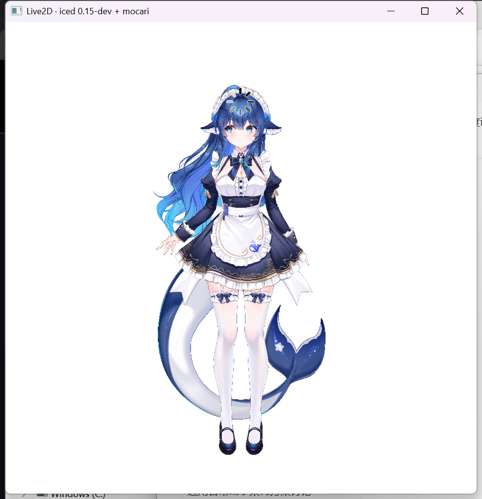
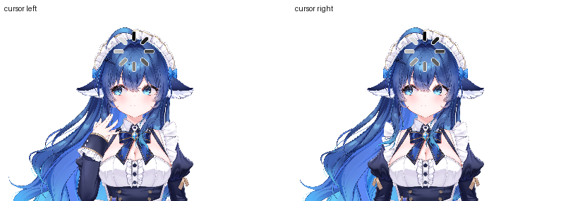

# Rust + iced 桌面端接 Live2D：可行性与方案

> 前提：开源项目、Rust、iced、桌面端（Win/macOS/Linux）
> **状态：已按路线 B 做出可运行的 spike**（模型、动作、表情、物理、视线跟随全部实测通过）。
> 实测环境：Windows 11 / RTX 5060 Laptop / Rust 1.97.1 / 显示缩放 150%
> 实测基线：`iced` master `e5c350f`（`0.15.0-dev`）+ `wgpu 30.0.2` + `mocari 0.4.1`（打 1 个补丁）

---

## 结论

**这条路是通的，而且比 C++/Cocos/Unity 路线更适合开源项目。** 现在已经不是"能不能"的问题，而是"剩下多少活"的问题。

代码在仓库里，直接跑：

```bash
cargo run --release -p app -- "<你的模型>/xxx.model3.json"
```



**难度评级：★★☆☆☆**（比原先估计低一档）。原因是路线 B 成立后，'遮罩化渲染器'这块 **一行都不用写**——mocari 的 `WgpuLive2dRenderer` 直接接受你给的 `RenderPass`，而 iced 的 `Primitive::render()` 恰好把 `CommandEncoder` 交到你手上。

**关键事实（决定架构）—— 版本矩阵**：

| 依赖 | wgpu | 备注 |
|---|---|---|
| `iced` 0.14.0（crates.io 稳定版） | **27** | `iced_wgpu 0.14.0` → `wgpu = "^27.0"` |
| `iced` master = `0.15.0-dev` | **30** | 实测 rev `e5c350f`；MSRV 1.93，edition 2024 |
| `mocari` 0.4.1（`wgpu` feature） | **30** | `wgpu = "^30.0.0"`，实测解析到 `30.0.2` |

→ 两条路，难度差一倍：

- **路线 A（iced 0.14，wgpu 27）**：mocari 的 wgpu 后端用不了 → 关掉 `mocari/wgpu`，**自己写 600–900 行渲染器**。
- **路线 B（iced master，wgpu 30）**：大版本对齐 → 复用 `WgpuLive2dRenderer`，只写 **约 300 行胶水**（实测：`app/src/live2d.rs` 200 行 + `crates/live2d-render` 450 行，后者还要自己写，但只是组织代码，不含渲染数学）。

**路线 B 的代价（实测，很小）**：

1. MSRV 1.93 —— 一次 `rustup update` 的事；
2. 升 rev 要处理 API 变动 —— 胶水只有 200 行，且 iced 自己的 git 依赖都是 rev 锁定的，你不主动升就完全稳定；
3. crates.io 上**没有 0.15 的任何 alpha/beta/rc**（最新仍是 0.14.0，2025-12-07），所以现在只能钉 git rev；等 0.15 发布切回来，胶水基本不动。

**结论：直接走 master + 钉 rev。** 已经在 `app/Cargo.toml` 里这么做了，同时 `Cargo.lock` 会锁死整棵树。

---

## 一、两条技术路线

| | A. mocari（纯 Rust） | B. Cubism Core FFI |
|---|---|---|
| 许可 | MIT，**零 Live2D 许可摩擦**，仓库干净 | Core 闭源，**仓库不能带二进制**，使用者需自己下载 SDK；发行时按 Live2D 协议走 |
| 构建 | `cargo add mocari`，纯 Rust | 需 C++ 工具链 + CMake + 自写 FFI 桥（现成只有 Core 裸绑定，不含 Framework，motion/physics 还得自己做） |
| 保真度 | **实测：遮罩/混合/物理/动作与官方 Viewer 观感一致**（见下图） | 官方级 |
| 成熟度 | 单人项目，5 个月 18 个版本，**API 会变**，且已有 1 个必须打补丁的 bug | 稳定，但绑定层要自己维护 |
| 依赖风险 | 项目消失 = 你接盘 | Live2D 条款变化 / Core 版本升级 |


上面这张是 `examples/offscreen.rs` 无窗口渲染出来的：睫毛/嘴巴/头发遮挡处的遮罩边缘干净，尾巴被身体挡住的部分正确裁剪，配色与官方 Viewer 一致。**这就是 mocari 的保真度证据**——比"看口碑"可靠。

**退出条件**（保留，但目前未触发）：如果 mocari 在目标模型上出现**遮罩错误 / 混合模式错误 / 动作变形与官方 Viewer 明显不一致**，且 2 周内定位不到根因 → 切 B 路线。

### mocari 0.4.1 实际能力

- `assets::load_model_runtime(path)`：加载 `.model3.json` + `.moc3` + 贴图 + physics + pose
- `ModelRuntime`：参数读写/归一化、参数覆盖（overrides）、physics、pose 淡入淡出、hit area、`update_meshes()`
- `motion::MotionPlayer`（循环/单次）、`expression::ExpressionManager`
- `render::wgpu`：`WgpuLive2dRenderer`（遮罩 pass、三种混合模式、mask RT、clip params 全现成）+ `WgpuMeshBuffers`（增量更新顶点）+ `WgpuClippingPlan`

### 它没给你的（你得自己写）

- 呼吸（breath）、自动眨眼（eye blink）——加到参数上的小逻辑，约 30 行
- 口型同步（MotionSync/音量驱动）——自己接音频 RMS/FFT
- 桌面宠物壳：透明/置顶/逐像素穿透/托盘

---

## 二、目标架构（实测版）

```
┌──────────────────────────── iced Application ────────────────────────────┐
│ view() → shader(&self.view).width(Fill).height(Fill)                     │
│ subscription: window::frames() + keyboard::listen()                      │
└──────────────────────────────────────────────────────────────────────────┘
                                   ↓
┌──────────────── Live2dPipeline（iced 只建一次，之后给 &mut）──────────────┐
│ 持有 Live2dScene：RuntimeModel + WgpuLive2dRenderer + 贴图 + mesh 缓冲    │
│ prepare(): 算 dt → motion.tick/apply → expression → overrides → physics   │
│            → pose → update_meshes() → 增量上传顶点 → 必要时重建裁剪资源    │
│ render():  pass A 画遮罩到 mask RT（1024²）                               │
│            pass B set_viewport/set_scissor(clip) 画模型到 iced 的 target  │
└──────────────────────────────────────────────────────────────────────────┘
```

**为什么必须用 `render()` 而不是 `draw()`**：`draw()` 拿到的是 iced 已开好、viewport/scissor 已设成 widget bounds 的 pass，**你无法在中间插入 mask 的离屏 pass**。所以 `draw()` 返回 `false`，在 `render()` 里自己开两个 pass。

**这是实测确认的行为**（`iced_wgpu/src/lib.rs`，`draw()` 返回 `false` 后）：

```
ManuallyDrop::into_inner(render_pass)          // iced 主动放弃它的 pass
for (instance, clip) { primitive.render(storage, encoder, frame, clip) }
render_pass = encoder.begin_render_pass(LoadOp::Load)   // 之后重开 pass 继续画 UI
```

→ 你的命令被按顺序插在 iced 自己的绘制之间，**不会**和你抢 pass。这正是 mocari 需要的。

### 关于颜色空间（原先的结论被实测推翻了）

**原来我写的是"必须垫一块 `Rgba8Unorm` 中间纹理，否则发灰"——在这套环境里不需要。** 实测 `Pipeline::new` 收到的 `format` 是 **`Bgra8Unorm`**（非 sRGB），和 mocari 的 gamma 空间混合假设**天然一致**，直接往 iced 的 target 上画即可，颜色正确（见上图）。

但仍要知道这个坑存在：iced 开 `web-colors`（默认）时，compositor 在有些平台/后端会优先选 sRGB 表面格式。**如果哪天你看到模型发灰/发白，第一件事是打印 `Pipeline::new` 收到的 `format`**：

- `Bgra8Unorm` / `Rgba8Unorm` → 直接画，正确；
- `*UnormSrgb` → 必须垫一块 `Rgba8Unorm` 中间纹理，再在 composite pass 里做 gamma→linear，否则双编码。

mocari 自己也有 `preferred_surface_format()`，逻辑就是"优先选非 sRGB"，和你想要的相反方向——它假设它拥有整个 surface。

---

## 三、iced 0.15-dev 实测细节（0.14 文档里查不到的部分）

1. **trait 搬家了**：`Pipeline` / `Primitive` / `Storage` 现在定义在 `iced_wgpu::primitive`，通过 `iced::widget::shader::{Pipeline, Primitive, Storage, Viewport}` 再导出。`Primitive` 的 `type Pipeline: Pipeline + MaybeSend + MaybeSync`，`Pipeline: Any + MaybeSend + MaybeSync`——**所以模型数据必须 `Send + Sync`**（mocari 的 `RuntimeModel` 满足）。
2. **`Pipeline::new(device, queue, format)` 现在有 `queue`**：贴图可以在 `new` 里就上传完。但**模型路径拿不到**——只能从 `Primitive` 带进来，在 `prepare` 里懒加载（spike 就是这么做的，失败时把错误存在 pipeline 里避免每帧重试）。
3. **`Program` 对 `&T` 有 blanket impl**：`shader(&self.view)` 传引用即可，`view()` 里不用 clone 状态。
4. **`window::frames()` 直接给 `Instant`**：`Subscription<Instant>`，不用再 `Instant::now()`。
5. **`prepare` 给的是逻辑 `bounds`，`render` 给的是物理 `clip_bounds`**：模型变换用 `bounds` 的宽高比算，viewport/scissor 用 `clip_bounds`（物理像素）设。**两者别混**。
6. **`Primitive` 要 `Debug`**：所以每帧的 primitive 只放轻量数据（路径、时间、光标、命令序号），GPU 资源全在 Pipeline 里。
7. **`Pipeline` 只在第一次 `prepare` 时创建**，之后同一个 `Pipeline` 实例被所有同类型 primitive 共享 —— 多窗口共享一个 Pipeline 是个坑，spike 只做单窗口。

---

## 四、真正会让你卡住的坑（按实测概率重排）

1. **模型数据里的脏值（已踩，必须打补丁）**：本模型有 1 个 drawable 的 mask 列表是 `[-1]`（导出器用它当"无遮罩"哨兵）。mocari 直接 `usize::try_from(-1)` → 报 `invalid mask drawable index -1`，整个模型加载失败。修法：在 `DrawableInfo::from_mesh` 里过滤负值。**见 `patches/mocari-0.4.1-negative-masks.patch`**，`scripts/vendor-mocari.ps1` 会重建 `.refs/mocari`。
2. **取景坐标系搞错（已踩）**：用"所有 drawable 的包围盒"去居中会**明显偏掉**——模型有 715 个 drawable，其中大量是隐藏的替换件（钢盆、脱鞋、替换手、替换体型），包围盒被它们拉歪。正确做法是用 `.moc3` 的 **canvas info**（`runtime.canvas()`：`pixels_per_unit` / `origin` / `width` / `height`），这才是美术设定的画面。注意 `reverse_y_coordinate` 为真时要退回包围盒。
3. **`model3.json` 不声明动作（已踩）**：这个 VTuber 模型的动作/表情文件都在 `Animation/`、`Exp3/` 子目录里，`FileReferences` 里**一个都没注册**。`Live2dScene::load` 会在 `model3.json` 为空时扫描模型目录（深度 2）兜底，并把 `IDLE*` 排到最前面。
4. **性能（实测数字）**：715 个 drawable、5 张 4096² 贴图、1024² mask RT、640² 逻辑窗口（1.5 倍缩放 → 960² 渲染）。
   - **release ≈ 48–50 fps**（够用）；
   - **debug ≈ 5 fps** —— 每帧 delta 超过 0.1s 限幅，动画变成慢放。**别用 debug 构建判断性能，也别用 debug 构建看动画是否正常**（这一条花了我半轮排查）。
5. **HiDPI / resize**：`bounds` 是逻辑像素、`viewport` 是物理像素。窗口跨显示器拖动时 `scale_factor` 会变，变换要在 `prepare` 里重算，别缓存成常量。spike 里用 `fit_aspect` 做脏检查。
6. **透明窗口**：`Level::AlwaysOnTop` + `transparent: true` + `decorations: false` + 根样式 alpha=0，缺一不可；`alpha_mode` 要 `PreMultiplied`。**跨平台表现不一致，三平台各测一次**。
7. **逐像素点击穿透**：iced 只提供整窗 `enable_mouse_passthrough`。要"只有角色可点"，拿 `window::raw_id()` / `HasWindowHandle` 自己处理：Windows 钩 `WM_NCHITTEST` 返回 `HTTRANSPARENT`，macOS 改 `ignoresMouseEvents`，Linux 走 X11 shape / Wayland input region。
8. **mocari 的 API 抖动**：5 个月 18 个版本，0.4.x 内部都不兼容。**锁死精确版本 + 本地 patch**，别用 `^`。

---

## 五、工作量（实测校准）

已花的时间（1 人，熟 Rust，会一点 wgpu，其中约 1/3 花在环境/工具链上）：

| 阶段 | 内容 | 实际 |
|---|---|---|
| S0 | 依赖打通（锁版本、拿到能编的三角组合） | 0.5 天（含沙箱 TLS 事故） |
| S1 | `live2d-render` 骨架：加载、取景、编码两个 pass | 0.5 天 |
| S2 | iced 胶水：`Program` / `Primitive` / `Pipeline` | 0.5 天（含读 master 源码） |
| S3 | 遮罩 + 颜色验证（**不用自己写**，验证即可） | 0.1 天 |
| S4 | 动画驱动 + 键盘/视线交互 | 0.3 天 |
| **已经跑通** | | **≈ 2 天** |

剩下的活（产品化）：

| 阶段 | 内容 | 人日 |
|---|---|---|
| P1 | 桌宠壳：透明/置顶/逐像素穿透/拖动/托盘/开机自启 | 4–6 |
| P2 | 待机策略：不可见/失焦降频，空闲时停止 `update_meshes` | 1–2 |
| P3 | 模型管理：导入目录、多模型切换、错误态（模型坏了不能白屏） | 2–3 |
| P4 | 眨眼/呼吸/口型同步 | 2–4 |
| P5 | 无头像素测试（`examples/offscreen.rs` 已经是雏形）+ 三平台 CI | 2–3 |
| **合计** | | **11–18 天 ≈ 2.5–3.5 周** |

比原先估的 3–4 周略少，因为 S1–S4 已被证明比预期便宜。

---

## 六、spike 落地记录（就是本仓库）

```
crates/live2d-render/          只依赖 wgpu + mocari，不依赖 iced（升级只改这一层）
  src/bounds.rs                canvas info → 取景矩阵
  src/scene.rs                 Live2dScene：加载、逐帧推进、两个 pass 的编码
  src/error.rs                 错误分类
  examples/dump.rs             模型结构体检（drawable 数、mask 集合、canvas、动作表）
  examples/offscreen.rs        无窗口渲染一帧成 PNG（CI 像素测试的雏形）
app/                           iced 0.15-dev 外壳
  src/main.rs                  application / subscription / 键盘
  src/live2d.rs                Program + Primitive + Pipeline（约 200 行）
.refs/mocari                   mocari 0.4.1 + 负 mask 索引修复（Cargo.toml 里 [patch.crates-io] 指过来）
patches/                       上面那个修复的 patch 文件
scripts/vendor-mocari.ps1      一键重建 .refs/mocari
scripts/shot.ps1               截图（DPI 感知，否则只截到左上角）
```

**内置操作**：`R` 下一段动作，`E` 下一个表情，鼠标移动 → 头部/眼球跟随（`ParamAngleX/Y/Z`、`ParamEyeBallX/Y`、`ParamBodyAngleX` 的 override）。

视线跟随实测（左 vs 右）：



---

## 七、替代方案的取舍（为什么不选别的）

| 方案 | 为什么不选 |
|---|---|
| Unity/UE 嵌进桌面应用 | 为一个窗宠引入 200MB+ 引擎，开源项目不可接受 |
| WebView + pixi-live2d-display | 又要塞 CEF/WebView2，透明与输入代理更麻烦，启动慢 |
| 直接绑 Cubism Native（C++/CMake） | 仓库带不了 Core，CI/贡献者体验差；FFI 面大 |
| `ayagami` | **motion/expression/pose 文件支持仍未实现**（第三方评测 2026-09），也没有正式发布版本，等于不能播动画 |
| egui + 自绘 | 不在你的技术栈；iced 的 shader widget 更省事 |

---

## 八、开源项目特有的三点

1. **仓库里不放模型和贴图**（版权归画师/Live2D）。本仓库的 `.gitignore` 已经排除 `*.moc3` 和模型目录，运行时用命令行参数传路径；将来做导入引导。
2. **mocari 是 MIT，可以放心用**。但我们打的补丁要**回报上游**——那是 mocari 的 bug，不该每个使用者自己维护。
3. **CI**：`examples/offscreen.rs` 已经能在无窗口环境下渲染一帧，把它的输出做个像素哈希就是回归测试。**这是唯一能防止"改一行渲染就白屏"的自动化手段**，建议早补。注意它在 CI 里需要能拿到 GPU/软件适配器（`wgpu` 的 lavapipe / WARP 均可）。

---

## 九、一句话总结

iced 给"窗口/循环/输入"，mocari 给"解析/动画/物理/遮罩渲染"，**你只负责把两者接起来 + 桌面宠物壳**。这条路上真正的技术风险已经从"能不能渲染"降到"mocari 的单人维护"——所以策略是**锁版本、打小补丁、用离屏像素测试锁住行为**，而不是重写渲染器。

---

## 参考

**iced master（0.15.0-dev，rev `e5c350f`）**
- `shader::Primitive` / `Pipeline`：<https://github.com/iced-rs/iced/blob/master/wgpu/src/primitive.rs>
- `Primitive::render` 的调用位置（draw 返回 false 之后）：<https://github.com/iced-rs/iced/blob/master/wgpu/src/lib.rs>
- `shader` widget / `Program`（含 `&T` 的 blanket impl）：<https://github.com/iced-rs/iced/blob/master/widget/src/shader.rs>
- `window::frames()`：<https://github.com/iced-rs/iced/blob/master/runtime/src/window.rs>
- 官方 `custom_shader` 示例：<https://github.com/iced-rs/iced/tree/master/examples/custom_shader>

**iced 0.14（稳定版，作为对照）**
- `shader` 模块：<https://docs.rs/iced_widget/0.14.0/iced_widget/shader/index.html>
- `window::Settings` / `window` 全部函数：<https://docs.rs/iced/0.14.0/iced/window/index.html>

**mocari 0.4.1**
- crate 页：<https://crates.io/crates/mocari>
- `ModelRuntime`：<https://docs.rs/mocari/0.4.1/mocari/runtime/struct.ModelRuntime.html>
- `render::wgpu`：<https://docs.rs/mocari/0.4.1/mocari/render/wgpu/index.html>（docs.rs 未带 `wgpu` feature，需看源码）
- 仓库：<https://github.com/Eatgrapes/Mocari>

**对照方案**
- Ayagami 现状：<https://hysenlabs.com/projects/ayagamidev-ayagami>
