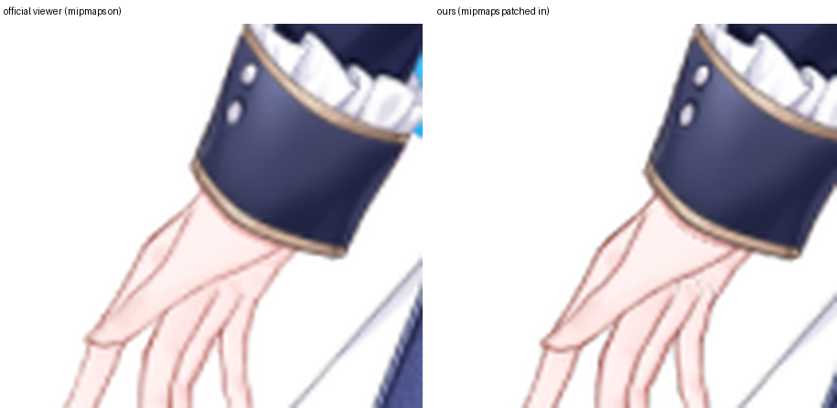

# Rust + iced 桌面端接 Live2D：可行性与方案

> 前提：开源项目、Rust、iced、桌面端（Win/macOS/Linux）
> **状态：已按路线 B 做出可运行的 spike**（模型、动作、表情、物理、视线跟随全部实测通过）。
> 实测环境：Windows 11 / RTX 5060 Laptop / Rust 1.97.1 / 显示缩放 150%
> 实测基线：`iced` master `e5c350f`（`0.15.0-dev`）+ `wgpu 30.0.2` + `mocari 0.4.1`（打 3 个补丁）

---

## 结论

**这条路是通的，而且比 C++/Cocos/Unity 路线更适合开源项目。** 现在已经不是"能不能"的问题，而是"剩下多少活"的问题。

代码在仓库里，直接跑：

```bash
cargo run --release -p app -- "<你的模型>/xxx.model3.json"
```


**难度评级：★★☆☆☆**（比原先估计低一档）。原因是路线 B 成立后，'遮罩化渲染器'这块 **一行都不用写**——mocari 的 `WgpuLive2dRenderer` 直接接受你给的 `RenderPass`，而 iced 的 `Primitive::render()` 恰好把 `CommandEncoder` 交到你手上。

**关键事实（决定架构）—— 版本矩阵**：

| 依赖 | wgpu | 备注 |
|---|---|---|
| `iced` 0.14.0（crates.io 稳定版） | **27** | `iced_wgpu 0.14.0` → `wgpu = "^27.0"` |
| `iced` master = `0.15.0-dev` | **30** | 实测 rev `e5c350f`；MSRV 1.93，edition 2024 |
| `mocari` 0.4.1（`wgpu` feature） | **30** | `wgpu = "^30.0.0"`，实测解析到 `30.0.2` |

→ 两条路，难度差一倍：

- **路线 A（iced 0.14，wgpu 27）**：mocari 的 wgpu 后端用不了 → 关掉 `mocari/wgpu`，**自己写 600–900 行渲染器**。
- **路线 B（iced master，wgpu 30）**：大版本对齐 → 复用 `WgpuLive2dRenderer`，**只写胶水加一个薄播放层**（实测：`app/src/live2d.rs` 217 行 iced 胶水 + `crates/live2d-render` 约 1 000 行播放/取景/诊断代码；渲染数学——遮罩、混合、物理——一行都没写）。

**路线 B 的代价（实测，很小）**：

1. MSRV 1.93 —— 一次 `rustup update` 的事；
2. 升 rev 要处理 API 变动 —— 胶水只有 200 多行，且 iced 自己的 git 依赖都是 rev 锁定的，你不主动升就完全稳定；
3. crates.io 上**没有 0.15 的任何 alpha/beta/rc**（最新仍是 0.14.0，2025-12-07），所以现在只能钉 git rev；等 0.15 发布切回来，胶水基本不动。

**结论：直接走 master + 钉 rev。** 已经在 `app/Cargo.toml` 里这么做了，同时 `Cargo.lock` 会锁死整棵树。

---

## 一、两条技术路线

| | A. mocari（纯 Rust） | B. Cubism Core FFI |
|---|---|---|
| 许可 | MIT，**零 Live2D 许可摩擦**，仓库干净 | Core 闭源，**仓库不能带二进制**，使用者需自己下载 SDK；发行时按 Live2D 协议走 |
| 构建 | `cargo add mocari`，纯 Rust | 需 C++ 工具链 + CMake + 自写 FFI 桥（现成只有 Core 裸绑定，不含 Framework，motion/physics 还得自己做） |
| 保真度 | **实测：遮罩/混合/物理/动作与官方 Viewer 观感一致**（见下图） | 官方级 |
| 成熟度 | 单人项目，5 个月 18 个版本，**API 会变**，且已有 3 个必须打补丁的 bug（负 mask 哨兵、无 mipmap、物理链路不传导） | 稳定，但绑定层要自己维护 |
| 依赖风险 | 项目消失 = 你接盘 | Live2D 条款变化 / Core 版本升级 |


上面这张是 `examples/offscreen.rs` 无窗口渲染出来的：睫毛/嘴巴/头发遮挡处的遮罩边缘干净，尾巴被身体挡住的部分正确裁剪，配色与官方 Viewer 一致。**这就是 mocari 的保真度证据**——比"看口碑"可靠。

**退出条件**（保留，但目前未触发）：如果 mocari 在目标模型上出现**遮罩错误 / 混合模式错误 / 动作变形与官方 Viewer 明显不一致**，且 2 周内定位不到根因 → 切 B 路线。

### mocari 0.4.1 实际能力

- `assets::load_model_runtime(path)`：加载 `.model3.json` + `.moc3` + 贴图 + physics + pose
- `ModelRuntime`：参数读写/归一化、参数覆盖（overrides）、physics、pose 淡入淡出、hit area、`update_meshes()`
- `motion::MotionPlayer`（循环/单次）、`expression::ExpressionManager`
- `render::wgpu`：`WgpuLive2dRenderer`（遮罩 pass、三种混合模式、mask RT、clip params 全现成）+ `WgpuMeshBuffers`（增量更新顶点）+ `WgpuClippingPlan`

### 它没给你的（你得自己写）

- 呼吸（breath）、自动眨眼（eye blink）——加到参数上的小逻辑，约 30 行
- 口型同步（MotionSync/音量驱动）——自己接音频 RMS/FFT
- 桌面宠物壳：透明/置顶/逐像素穿透/托盘

---

## 二、目标架构（实测版）

```
┌──────────────────────────── iced Application ────────────────────────────┐
│ view() → shader(&self.view).width(Fill).height(Fill)                     │
│ subscription: window::frames() + keyboard::listen()                      │
└──────────────────────────────────────────────────────────────────────────┘
                                   ↓
┌──────────────── Live2dPipeline（iced 只建一次，之后给 &mut）──────────────┐
│ 持有 Live2dScene：RuntimeModel + WgpuLive2dRenderer + 贴图 + mesh 缓冲    │
│ prepare(): 算 dt → motion.tick/apply → expression → overrides → physics   │
│            → pose → update_meshes() → 增量上传顶点 → 必要时重建裁剪资源    │
│ render():  pass A 画遮罩到 mask RT（1024²）                               │
│            pass B set_viewport/set_scissor(clip) 画模型到 iced 的 target  │
└──────────────────────────────────────────────────────────────────────────┘
```

**为什么必须用 `render()` 而不是 `draw()`**：`draw()` 拿到的是 iced 已开好、viewport/scissor 已设成 widget bounds 的 pass，**你无法在中间插入 mask 的离屏 pass**。所以 `draw()` 返回 `false`，在 `render()` 里自己开两个 pass。

**这是实测确认的行为**（`iced_wgpu/src/lib.rs`，`draw()` 返回 `false` 后）：

```
ManuallyDrop::into_inner(render_pass)          // iced 主动放弃它的 pass
for (instance, clip) { primitive.render(storage, encoder, frame, clip) }
render_pass = encoder.begin_render_pass(LoadOp::Load)   // 之后重开 pass 继续画 UI
```

→ 你的命令被按顺序插在 iced 自己的绘制之间，**不会**和你抢 pass。这正是 mocari 需要的。

### 关于颜色空间（原先的结论被实测推翻了）

**原来我写的是"必须垫一块 `Rgba8Unorm` 中间纹理，否则发灰"——在这套环境里不需要。** 实测 `Pipeline::new` 收到的 `format` 是 **`Bgra8Unorm`**（非 sRGB），和 mocari 的 gamma 空间混合假设**天然一致**，直接往 iced 的 target 上画即可，颜色正确（见上图）。

但仍要知道这个坑存在：iced 开 `web-colors`（默认）时，compositor 在有些平台/后端会优先选 sRGB 表面格式。**如果哪天你看到模型发灰/发白，第一件事是打印 `Pipeline::new` 收到的 `format`**：

- `Bgra8Unorm` / `Rgba8Unorm` → 直接画，正确；
- `*UnormSrgb` → 必须垫一块 `Rgba8Unorm` 中间纹理，再在 composite pass 里做 gamma→linear，否则双编码。

mocari 自己也有 `preferred_surface_format()`，逻辑就是"优先选非 sRGB"，和你想要的相反方向——它假设它拥有整个 surface。

---

## 二·五、物理：mocari 实现了什么，以及那个最容易踩的坑

**mocari 的物理是 Cubism `CubismPhysics` 的忠实移植**（读 `src/core/physics.rs` 确认）：

- 从 `.model3.json` 的 `Physics` 字段自动加载（`load_model_runtime` 内部 `set_physics`）；
- `apply_physics(dt)` 按 `PhysicsSetting` 逐条求值：输入按 min/default/max 归一化、`Reflect`、逐顶点的 `Mobility/Delay/Acceleration`、固定步长（用文件里的 `Fps`，通常 30Hz）子步进、输入插值（`input_weight`）、输出插值（`alpha`）、按 `Weight/100` 与现有值混合、`dt <= 0` 直接返回、累计时间超过 `MAXIMUM_DELTA_TIME` 归零；
- 重力/风力可调（`PhysicsOptions`，默认 `gravity = (0, -1)`）。

这个模型实测：**131 组 setting / 299 输入 / 292 输出**，头发、眼睑、眉毛、腮、衣饰、缎带全挂在上面。

### 坑 0（最坑的一个）：mocari 的 `*_normalized` 是 `0..=1`，不是 `-1..=1`

```rust
fn raw_parameter_value_from_normalized_range(minimum: f32, maximum: f32, value: f32) -> f32 {
    let amount = value.clamp(0.0, 1.0);      // <- 0..=1
    minimum + (maximum - minimum) * amount
}
```

mocari 的文档写的就是“normalized `0.0..=1.0`”，但 Cubism 的追踪输入习惯是 `-1.0..=1.0`。把 `-1..1` 直接丢进去，**负数全被 `clamp` 到 0 → 参数恒等于 `minimum`**。

表现：鼠标在角色中线**左侧**滑动时模型完全不动（`AngleX` 卡在 -30），一越过中线才开始跟随，看起来就是“过中线时身体顿一下”。而且**四角测试（±1）恰好两端都对**——`-1` 夹到 0 正好等于 `minimum`——所以这个 bug 很容易漏过目检。

正确的写法（`scene.rs` 的 `write_normalized_override`，所有追踪写入都走它）：

```rust
let amount = (offset.clamp(-1.0, 1.0) + 1.0) * 0.5;
runtime.set_parameter_override_normalized(id, amount);
```

`examples/sweep.rs` 就是为这个写的：以 60 fps 把输入从 -1 扫到 +1，打印输入参数与物理输出。**修之前的输入列会在 -30 上停住 100 多帧，修之后是线性的**。任何“鼠标跟踪手感不对”的问题都先用它验一遍，比肉眼看快得多。

### 坑 1（必踩）：物理的输出参数不能写，要写输入参数

VTuber 导出的绑定通常是这样分层的：

| 参数 | 角色 | 范围 |
|---|---|---|
| `AngleX/Y/Z`、`PositionX/Y/Z`、`LeanInput`、`Movement1..3` | **追踪输入**（app 只能写这里；本模型实际只写其中 5 条，见下表） | ±30 |
| `ParamAngleX/Y/Z`、`ParamBodyAngleX/Y/Z`、大量 `Hair*` | **物理输出**（物理写这里） | ±30 |

`update_output_parameter` 在 `weight >= 1.0` 时是**直接替换**：

```rust
*parameter_value = if weight >= 1.0 { value } else { lerp(old, value, weight) };
```

所以：如果你把 `ParamAngleX` 当输入写，同一帧稍后的 `apply_physics` 会用 `AngleX`(=0) 推出的结果把它覆盖掉 —— **表现就是“鼠标动了，只有头发在摆，头和眼睛不动”**。

代码里按“有 `AngleX` 就写追踪输入，否则退回 `ParamAngle*`”自动选择（`crate::rig::resolve`）。至于具体写哪几条——**照官方 Viewer 的默认绑定表写，一条也别多加**：

| 参数 | 绑定 |
|---|---|
| `AngleX` | 鼠标 X |
| `AngleY` | 鼠标 Y |
| `ParamBodyAngleX` | 鼠标 X |
| `ParamEyeBallX` | 鼠标 X |
| `ParamEyeBallY` | 鼠标 Y |

其余全部“未设置”。我们一度多写了 `AngleZ` / `PositionX/Y` / `LeanInput`（官方未绑），又漏了 `ParamBodyAngleX`，两边画面因此根本对不上——**多余的输入会被物理链放大成明显的姿态差异**，而本项目的验收手段就是和参考渲染器对比，所以不能“顺手加戏改进跟踪”。

#### 鼠标该绑哪些参数：看模型自带的 VTube Studio 配置

模型目录里的 `大肥鱼.vtube.json` 是艺术家/VUP 保存的 VTube Studio 配置，其中的
`ParameterSettings` 直接写明了“追踪输入 → Live2D 参数”的映射：

| VTS 输入 | → Live2D 参数 | 用途 |
|---|---|---|
| `FaceAngleX` / `FaceAngleY` / `FaceAngleZ` | `AngleX` / `AngleY` / `AngleZ` | 头部 |
| `FaceAngleX` / `FaceAngleY` / `FaceAngleZ` | `PositionX` / `PositionY` / `PositionZ` | 身体（“身体X/Y/Z”三行） |
| `EyeRightX` / `EyeRightY` | `ParamEyeBallX` / `ParamEyeBallY` | 眼珠 |
| （自动） | `ParamBreath` / `ParamEyeLOpen` / `ParamEyeROpen` | 呼吸、眨眼 |

`ParamAngleX/Y/Z` 在整个 `vtube.json` 里**一次都没出现**——它们只是
`PhysicsSetting1/2/3` 的输出，不是给外部写的。

Cubism Viewer 的默认鼠标跟踪把 `ParamAngleX`/`ParamBodyAngleX` 绑到鼠标，那是个**通用默认**，
不认这份工程的输入参数约定；这两个是物理输出，物理一开就被覆盖，于是 Viewer 里
“物理开只跟眼睛、物理关才全身动”。三种写法实测对照：

| 写入 | 物理开 | 物理关 |
|---|---|---|
| `ParamAngleX`（Viewer 默认） | 0（被 `Setting1` 覆盖） | +30 |
| `AngleX`（艺术家约定） | 物理推出 `ParamAngleX` = +13.8 | 0（没人消费） |
| `PositionX`（艺术家约定） | 物理推出 `ParamBodyAngleX`，躯干/手臂跟着转 | 直接生效 |

所以“身体不动”既不是模型缺陷也不是渲染器缺陷：**是没喂 `PositionX`**。补上之后
（`Live2dScene::look_at` 现在也写 `PositionX`/`PositionY`），物理开着画面下半部也会动：

| | 只写 `AngleX`/`AngleY` | 加上 `PositionX`/`PositionY` |
|---|---|---|
| 每帧变化像素（±1 全程） | 中位 1 931 | 中位 9 554 |
| 变化中心 y（480 px 画布） | ≈124（脸/头发） | ≈232（胸口，上身整体） |

#### 适配层：`crate::rig` 把“参数名”收敛成“意图”

不同工程对“谁该被外部写”分歧很大（`ParamAngleX` 是输入还是物理输出、有没有
`PositionX`、有没有 `LeanInput`…），所以绑定不再写死在代码里，而是**按模型解析**：

- 六个语义槽位：`head-yaw` / `head-pitch` / `body-yaw` / `body-lean` / `eye-x` / `eye-y`；
- 每条解析结果带 `route`（`through-physics` 或 `direct`）和 `source`
  （`physics-input` / `convention` / `viewer-default`），**为什么这么绑是可打印的**；
- 判据来自 `physics3.json`：如果约定名（`ParamAngleX`）是某个 setting 的输出，就去用它真正的输入
  （`AngleX`）；否则直接用约定名。解析器是纯函数，有 5 个单元测试覆盖两种 rig 形态。

两种模式（`SceneOptions::look_at_mode`，或在 app / 所有 example 里用 `LIVE2D_TRACK` 切换）：

| 模式 | 行为 | 实测（±1 全程，每帧变化像素） |
|---|---|---|
| `adapted`（默认） | 按工程约定：`AngleX/Y` + `PositionX/Y` → 物理 → `ParamAngle*`/`ParamBodyAngle*` | 中位 **11 593**，头/躯干/头发都动 |
| `viewer` | 复刻 Cubism Viewer 的默认绑定：`ParamAngleX/Y`、`ParamBodyAngleX` + 眼珠 | 中位 **20**，只有眼珠动——与 Viewer 一致，用于逐像素对照 |

换模型时先跑 `cargo run -p live2d-render --example rig -- <model>`，它不用开 GPU 就能打印两张表：

```
== adapted ==
  head-yaw    -> AngleX             through-physics  (physics-input)
  body-yaw    -> PositionX          through-physics  (physics-input)
== viewer ==
  head-yaw    -> ParamAngleX        direct           (viewer-default)
```

> **已确认并已打补丁**：mocari 0.4.1 的 `evaluate_setting` 把重新绑定后的缓存值当成计算结果写回，
> 等于 `cache = blend(cache, cache)`，所以物理输出**永远进不了** `parameter_cache`；本模型 **113 处**
> 跨 setting 读取因此全部失效（`AngleX → ParamAngleX → 前发/后发`、`ParamBodyAngleX → 十余处`、
> `ParamBreath → 胸腔/裙摆` …）。官方实现写的就是缓存，并且注释点名这是链路传导机制。
> 补丁：`patches/mocari-0.4.1-chained-physics.patch`；实测 `FrontHairX1` 由 0.000 变为 -0.136。
> 完整记录见 [`mocari-chained-physics.md`](mocari-chained-physics.md)。

### 坑 2：`ParamBreath` 存在，但没人驱动它

（**更正**：本文早前版本说这个绑定“没有 `ParamBreath`”，那是我筛参数时输出被 `head` 截断导致的误判。实测 `ParamBreath` 存在，范围 0..1，默认 0。）

- `大肥鱼.physics3.json` 引用 `ParamBreath` **30 次**（作为输入），所以呼吸链路是**通的**，只是值恒为 0；
- 官方 SDK 里这个值由 **`CubismBreath`** 组件（app 层）按正弦写入，mocari **没有**实现它；
- 同理 **`CubismEyeBlink`** 也没有，`ParamEyeLOpen/ROpen` 存在但没人驱动，模型不会眨眼。

这两个组件都是 20–40 行，属于“必须自己写”的清单。**不写它们，物理表现会明显偏死**（胸口、裙摆、缎带的一大半联动都挂在 `ParamBreath` 上）。

### 解析正确性：与官方 Viewer 的统计逐项核对（全中）

Cubism Viewer 的“Moc 统计信息”可以直接和 `examples/inspect.rs` 的输出对比：

| 项 | 官方 Viewer | mocari + 我们的 `-1` 补丁 |
|---|---|---|
| Drawable | 715 | 715 |
| 顶点 / 多边形 | 58 967 / 88 668 | 58 967 / 88 668 |
| 纹理使用 | 5（0:216 / 1:407 / 2:57 / 3:30 / 4:5） | 完全一致 |
| 剪贴数 | 181 | 181 |
| 蒙版 / 反转蒙版 | 130 / 51 | 130 / 51 |
| 蒙版 ID 排列种类 | 49 | 49 |
| 部件 / 参数 | 147 / 509 | 147 / 509 |

注意“剪贴数 181”正是排除了那个 `-1` 哨兵之后的数量（原始数据里被标记的 drawable 有 182 个），**这验证了“把 -1 当作无遮罩”的补丁与官方语义一致**。这条对比建议以后每换一个模型都做一遍，比肉眼看快得多。

### 坑 3：mocari 上传贴图不生成 mipmap，细线稿会被采成虚线

Cubism 的贴图是 4096–8192px，桌面宠物只画几百像素，等于 4–8 倍缩小。mocari 的 `create_rgba8_texture` 用 `mip_level_count: 1`，于是每个像素只有一次双线性采样：贴图里 1px 宽的线稿会**命中一部分片元、漏掉相邻的**，看起来就是虚线/麻点（本模型的“手”是半透明淡粉 + 细棕线，正好把这个缺陷放大）。

**官方 Viewer 默认是开 mipmap 的**（用户实测确认），所以同一区域在 Viewer 里是连续的。

修法：上传时在 CPU 侧生成整条 mip 链 + sampler 的 `mipmap_filter = Linear`。代价 +33% 显存、这个规模的模型约 +0.5s 启动。见 `patches/mocari-0.4.1-mipmaps.patch`。



### 坑 4：贴图分辨率与输出分辨率的匹配

同一个输出尺寸下，`texture_scale = 0.5`（2048–4096px）反而比 1.0（4096–8192px）**看起来更干净**——在没有 mipmap 的情况下，缩小倍数越大混叠越严重。有了 mipmap 之后这条规律消失，可以放心用高分辨率贴图换内存。

---

## 三、iced 0.15-dev 实测细节（0.14 文档里查不到的部分）

1. **trait 搬家了**：`Pipeline` / `Primitive` / `Storage` 现在定义在 `iced_wgpu::primitive`，通过 `iced::widget::shader::{Pipeline, Primitive, Storage, Viewport}` 再导出。`Primitive` 的 `type Pipeline: Pipeline + MaybeSend + MaybeSync`，`Pipeline: Any + MaybeSend + MaybeSync`——**所以模型数据必须 `Send + Sync`**（mocari 的 `RuntimeModel` 满足）。
2. **`Pipeline::new(device, queue, format)` 现在有 `queue`**：贴图可以在 `new` 里就上传完。但**模型路径拿不到**——只能从 `Primitive` 带进来，在 `prepare` 里懒加载（spike 就是这么做的，失败时把错误存在 pipeline 里避免每帧重试）。
3. **`Program` 对 `&T` 有 blanket impl**：`shader(&self.view)` 传引用即可，`view()` 里不用 clone 状态。
4. **`window::frames()` 直接给 `Instant`**：`Subscription<Instant>`，不用再 `Instant::now()`。
5. **`prepare` 给的是逻辑 `bounds`，`render` 给的是物理 `clip_bounds`**：模型变换用 `bounds` 的宽高比算，viewport/scissor 用 `clip_bounds`（物理像素）设。**两者别混**。
6. **`Primitive` 要 `Debug`**：所以每帧的 primitive 只放轻量数据（路径、时间、光标、命令序号），GPU 资源全在 Pipeline 里。
7. **`Pipeline` 只在第一次 `prepare` 时创建**，之后同一个 `Pipeline` 实例被所有同类型 primitive 共享 —— 多窗口共享一个 Pipeline 是个坑，spike 只做单窗口。

---

## 四、真正会让你卡住的坑（按实测概率重排）

1. **模型数据里的脏值（已踩，必须打补丁）**：本模型有 1 个 drawable 的 mask 列表是 `[-1]`（导出器用它当"无遮罩"哨兵）。mocari 直接 `usize::try_from(-1)` → 报 `invalid mask drawable index -1`，整个模型加载失败。修法：在 `DrawableInfo::from_mesh` 里过滤负值。**见 `patches/mocari-0.4.1-negative-masks.patch`**；另一个必打的补丁是 mipmap（见坑 3）。`scripts/vendor-mocari.ps1` 会把 `patches/` 下所有补丁按文件名顺序加到 `.refs/mocari`。
2. **取景坐标系搞错（已踩）**：用"所有 drawable 的包围盒"去居中会**明显偏掉**——模型有 715 个 drawable，其中大量是隐藏的替换件（钢盆、脱鞋、替换手、替换体型），包围盒被它们拉歪。正确做法是用 `.moc3` 的 **canvas info**（`runtime.canvas()`：`pixels_per_unit` / `origin` / `width` / `height`），这才是美术设定的画面。注意 `reverse_y_coordinate` 为真时要退回包围盒。
3. **`model3.json` 不声明动作（已踩）**：这个 VTuber 模型的动作/表情文件都在 `Animation/`、`Exp3/` 子目录里，`FileReferences` 里**一个都没注册**。`Live2dScene::load` 会在 `model3.json` 为空时扫描模型目录（深度 2）兜底，并把 `IDLE*` 排到最前面。
4. **性能（实测数字）**：715 个 drawable、5 张 4096² 级别贴图、1024² mask RT、640² 逻辑窗口（1.5 倍缩放 → 960² 渲染）。
   - **修完第四个 mocari 补丁后 release 稳 60 fps**（`steps` 恒为 1.00，帧时间 ≈ 4.5–5 ms CPU）；补丁前是 ≈ 35 fps；
   - **debug ≈ 5 fps** —— 每帧 delta 超过 0.1s 限幅，动画变成慢放。**别用 debug 构建判断性能，也别用 debug 构建看动画是否正常**（这一条花了我半轮排查）。
   - **CPU 是瓶颈，不是 GPU，而且瓶颈一开始藏起来了**：实测 `advance()` 每帧 **rebuild 3.6 ms + upload 18 ms**。那 18 ms 的直觉答案是"715 个 drawable 每帧 `queue.write_buffer` 一次"，但真正的元凶是 `update_drawables` 因为**动态遮罩**每帧返回 Err（本 rig 的 drawable 373 每帧都换遮罩），调用方只能整套重建 GPU buffer。修法见第四个补丁：共享顶点 buffer（一帧一次写）+ 遮罩/贴图/混合模式就地更新并只重建 clipping 资源，**upload 18 ms → 1.2 ms**。对比：Haru 这类几十个 drawable 的模型是同一步 **0.1 ms + 0.04 ms**。
   - **教训**：被 `Err(_)` 吞掉的原因既看不见又最贵。现在这个分支会把第一次遇到的 `WgpuMeshUpdateError` 作为 issue 抛出来（同一原因只报一次），`LIVE2D_PROFILE=1` 里的 `upload`/`mesh`/`clip` 分项也保留着，方便下次一眼看出是谁慢。
5. **内存：贴图是绝对大头，而且很容易泄漏一份**（实测 1 565 MB → 462 MB）：
   - 这 5 张贴图是 4096×8192、4096×8192、2048×2048、**8192×8192**、4096×4096，未压缩共 **592 MB**；
   - `load_model_runtime` 返回的 `RuntimeModel` 里**同时持有解码后的 RGBA**，如果把它留在场景结构里，就是 CPU 592 MB + GPU 592 MB ≈ **1.5 GB**；
   - 修法：`loaded.runtime().clone()` 之后 `drop(loaded)`（mocari 官方示例就是这么做的），再给一个 `texture_scale`（0.5 → 148 MB GPU），总占用降到 **462 MB**。
6. **别用 cargo 重放的警告判断源码状态**：`cargo build` 会对"未重新编译"的依赖**重放上次的编译警告**。我改坏过一个 vendored 依赖、又改回来，但产物没重编，于是画面异常却看不到任何警告（反而看到旧的）。**怀疑构建不一致时：`cargo clean -p <crate> --release` 再编，确认警告一起消失。**
7. **不能相信宿主给的帧间隔（已踩）**：iced 的 `window::frames()` 每秒会有 2–10% 的消息带着**和上一条相同的 `Instant`**，于是 `advance(0)` 拿到零长度 delta。当零长度被当成正常帧处理时，模型每帧先 `reset_parameters()` 再 `apply_physics(0.0)`，而 mocari 的 physics 在 `delta <= 0` 时**直接返回、不写输出参数**，结果就是物理驱动的部件（头发、裙摆、配件）恢复到默认姿势一帧再弹回来——肉眼看到的就是"部分组件频闪"。大肥鱼看不出来只是因为它每帧 ~28 ms，iced 基本不会给它重复 instant。修法：`Live2dScene` 内部做**固定 1/60 s 步进累加器**（`Stepper`），零长度帧自然变成 no-op，同一段时长切成什么样都会得到同一姿势（这也是后面像素回归测试的前提）。
8. **HiDPI / resize**：`bounds` 是逻辑像素、`viewport` 是物理像素。窗口跨显示器拖动时 `scale_factor` 会变，变换要在 `prepare` 里重算，别缓存成常量。spike 里用 `fit_aspect` 做脏检查。
9. **透明窗口**：`Level::AlwaysOnTop` + `transparent: true` + `decorations: false` + 根样式 alpha=0，缺一不可；`alpha_mode` 要 `PreMultiplied`。**跨平台表现不一致，三平台各测一次**。
10. **逐像素点击穿透**：iced 只提供整窗 `enable_mouse_passthrough`。要"只有角色可点"，拿 `window::raw_id()` / `HasWindowHandle` 自己处理：Windows 钩 `WM_NCHITTEST` 返回 `HTTRANSPARENT`，macOS 改 `ignoresMouseEvents`，Linux 走 X11 shape / Wayland input region。
11. **mocari 的 API 抖动**：5 个月 18 个版本，0.4.x 内部都不兼容。**锁死精确版本 + 本地 patch**，别用 `^`。

---

## 五、工作量（实测校准）

已花的时间（1 人，熟 Rust，会一点 wgpu，其中约 1/3 花在环境/工具链上）：

| 阶段 | 内容 | 实际 |
|---|---|---|
| S0 | 依赖打通（锁版本、拿到能编的三角组合） | 0.5 天（含沙箱 TLS 事故） |
| S1 | `live2d-render` 骨架：加载、取景、编码两个 pass | 0.5 天 |
| S2 | iced 胶水：`Program` / `Primitive` / `Pipeline` | 0.5 天（含读 master 源码） |
| S3 | 遮罩 + 颜色验证（**不用自己写**，验证即可） | 0.1 天 |
| S4 | 动画驱动 + 键盘/视线交互 | 0.3 天 |
| **已经跑通** | | **≈ 2 天** |

剩下的活（产品化）：

| 阶段 | 内容 | 人日 |
|---|---|---|
| P1 | 桌宠壳：透明/置顶/逐像素穿透/拖动/托盘/开机自启 | 4–6 |
| P2 | 待机策略：不可见/失焦降频，空闲时停止 `update_meshes` | 1–2 |
| P3 | 模型管理：导入目录、多模型切换、错误态（模型坏了不能白屏） | 2–3 |
| P4 | 眨眼/呼吸/口型同步 | 2–4 |
| P5 | 无头像素测试（`examples/offscreen.rs` 已经是雏形）+ 三平台 CI | 2–3 |
| **合计** | | **11–18 天 ≈ 2.5–3.5 周** |

比原先估的 3–4 周略少，因为 S1–S4 已被证明比预期便宜。

---

## 六、spike 落地记录（就是本仓库）

```
crates/live2d-render/          只依赖 wgpu + mocari，不依赖 iced（升级只改这一层）
  src/bounds.rs                canvas info → 取景矩阵
  src/scene.rs                 Live2dScene：加载、逐帧推进、两个 pass 的编码
  src/error.rs                 错误分类（含"不致命但必须让用户看见"的问题队列）
  examples/dump.rs             模型结构体检（drawable 数、mask 集合、canvas、动作表）
  examples/inspect.rs          文件内容体检（物理 setting、动作曲线、表情目标）
  examples/probe.rs            某点由哪些 drawable 覆盖（按绘制顺序）
  examples/switch.rs           某参数会翻转哪些 drawable
  examples/sweep.rs            60 fps 扫视线，打印物理输入/输出（查跟踪 bug）
  examples/offscreen.rs        无窗口渲染一帧成 PNG（CI 像素测试的雏形）
  examples/jolt.rs             慢扫视线，逐帧比较渲染结果，找"顿一下"的位置
  examples/shared/gpu.rs       上面两个需要 GPU 的例子的公共引导
app/                           iced 0.15-dev 外壳
  src/main.rs                  application / subscription / 键盘
  src/live2d.rs                Program + Primitive + Pipeline
.refs/mocari                   mocari 0.4.1 + 四个补丁（Cargo.toml 里 [patch.crates-io] 指过来）
patches/                       负 mask 索引 + mipmap + 物理链路三个修复的 patch 文件
scripts/vendor-mocari.ps1      一键重建 .refs/mocari
scripts/shot.ps1               截图（DPI 感知，否则只截到左上角）
scripts/shot-window.ps1        按标题前缀截任意窗口（用来截官方 Viewer 做对比）
```

**内置操作**：`R` 下一段动作，`E` 下一个表情，鼠标移动 → 头部/眼球跟随。写入的是官方 Viewer 默认的那 5 条绑定（`AngleX`、`AngleY`、`ParamBodyAngleX`、`ParamEyeBallX`、`ParamEyeBallY`），`ParamAngle*` 由物理推出。

视线跟随实测（左 vs 右）：


同一姿势下与官方 Viewer 的逐像素对照见仓库根目录 `README.md` 的「Fidelity」一节。

---

## 七、替代方案的取舍（为什么不选别的）

| 方案 | 为什么不选 |
|---|---|
| Unity/UE 嵌进桌面应用 | 为一个窗宠引入 200MB+ 引擎，开源项目不可接受 |
| WebView + pixi-live2d-display | 又要塞 CEF/WebView2，透明与输入代理更麻烦，启动慢 |
| 直接绑 Cubism Native（C++/CMake） | 仓库带不了 Core，CI/贡献者体验差；FFI 面大 |
| `ayagami` | **motion/expression/pose 文件支持仍未实现**（第三方评测 2026-09），也没有正式发布版本，等于不能播动画 |
| egui + 自绘 | 不在你的技术栈；iced 的 shader widget 更省事 |

---

## 八、开源项目特有的三点

1. **仓库里不放模型和贴图**（版权归画师/Live2D）。本仓库的 `.gitignore` 已经排除 `*.moc3` 和模型目录，运行时用命令行参数传路径；将来做导入引导。
2. **mocari 是 MIT，可以放心用**。但我们打的补丁要**回报上游**——那是 mocari 的 bug，不该每个使用者自己维护。
3. **CI**：`examples/offscreen.rs` 已经能在无窗口环境下渲染一帧，把它的输出做个像素哈希就是回归测试。**这是唯一能防止"改一行渲染就白屏"的自动化手段**，建议早补。注意它在 CI 里需要能拿到 GPU/软件适配器（`wgpu` 的 lavapipe / WARP 均可）。

---

## 九、一句话总结

iced 给"窗口/循环/输入"，mocari 给"解析/动画/物理/遮罩渲染"，**你只负责把两者接起来 + 桌面宠物壳**。这条路上真正的技术风险已经从"能不能渲染"降到"mocari 的单人维护"——所以策略是**锁版本、打小补丁、用离屏像素测试锁住行为**，而不是重写渲染器。

---

## 参考

**iced master（0.15.0-dev，rev `e5c350f`）**
- `shader::Primitive` / `Pipeline`：<https://github.com/iced-rs/iced/blob/master/wgpu/src/primitive.rs>
- `Primitive::render` 的调用位置（draw 返回 false 之后）：<https://github.com/iced-rs/iced/blob/master/wgpu/src/lib.rs>
- `shader` widget / `Program`（含 `&T` 的 blanket impl）：<https://github.com/iced-rs/iced/blob/master/widget/src/shader.rs>
- `window::frames()`：<https://github.com/iced-rs/iced/blob/master/runtime/src/window.rs>
- 官方 `custom_shader` 示例：<https://github.com/iced-rs/iced/tree/master/examples/custom_shader>

**iced 0.14（稳定版，作为对照）**
- `shader` 模块：<https://docs.rs/iced_widget/0.14.0/iced_widget/shader/index.html>
- `window::Settings` / `window` 全部函数：<https://docs.rs/iced/0.14.0/iced/window/index.html>

**mocari 0.4.1**
- crate 页：<https://crates.io/crates/mocari>
- `ModelRuntime`：<https://docs.rs/mocari/0.4.1/mocari/runtime/struct.ModelRuntime.html>
- `render::wgpu`：<https://docs.rs/mocari/0.4.1/mocari/render/wgpu/index.html>（docs.rs 未带 `wgpu` feature，需看源码）
- 仓库：<https://github.com/Eatgrapes/Mocari>

**对照方案**
- Ayagami 现状：<https://hysenlabs.com/projects/ayagamidev-ayagami>
